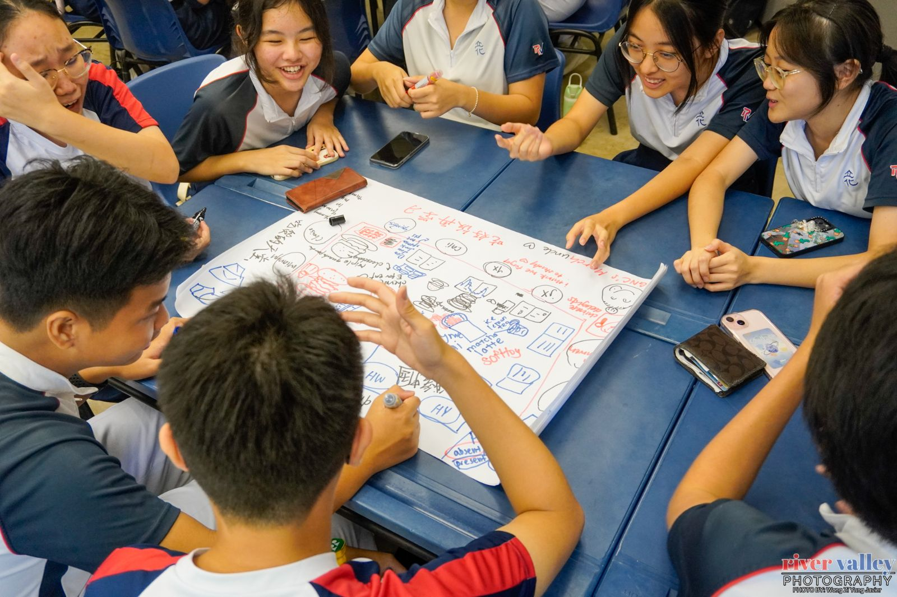

# ECG@RVHS
{: .fs-9 }

**Discover** your purpose · **Explore** possibilities · **Plan** your path
{: .fs-6 .fw-300 }

At RVHS, Education and Career Guidance (ECG) helps every student understand who they are, explore education and career possibilities, and make informed decisions about their future.



## Start here

[I'm a Secondary student](my-ecg-journey.md#secondary){: .btn .btn-primary }
[I'm a JC student](my-ecg-journey.md#jc){: .btn .btn-primary }
[I'm a parent](for-parents.md){: .btn .btn-primary }

New here? How to find your way around

1. **Start with the button above that fits you.** It takes you to the part of the site written for you.
2. **Follow the menu, or search.** Each page in the menu answers one question, in the order most students ask them: from *What happens at my level, and what should I do this year?* down to *How can I pay for university?* Know what you're looking for? Use the search box at the top of any page.
3. **Still stuck? Ask a person.** [Book a session](get-help.md#book-a-session) or [send us a question](https://docs.google.com/forms/d/e/1FAIpQLSeOE8cXBpMHC2tbjBdEsutPvv78ClxrqpQtn8lb81KaPvbzGQ/viewform).

*Sec 4 MBTI workshop, May 2025*

## Right now

[Current Opportunities](opportunities.md){: .btn }

Where to find internships, programmes and jobs you can apply for now.



## Need a person?

[Book an ECG session or find who to ask](get-help.md){: .btn }
